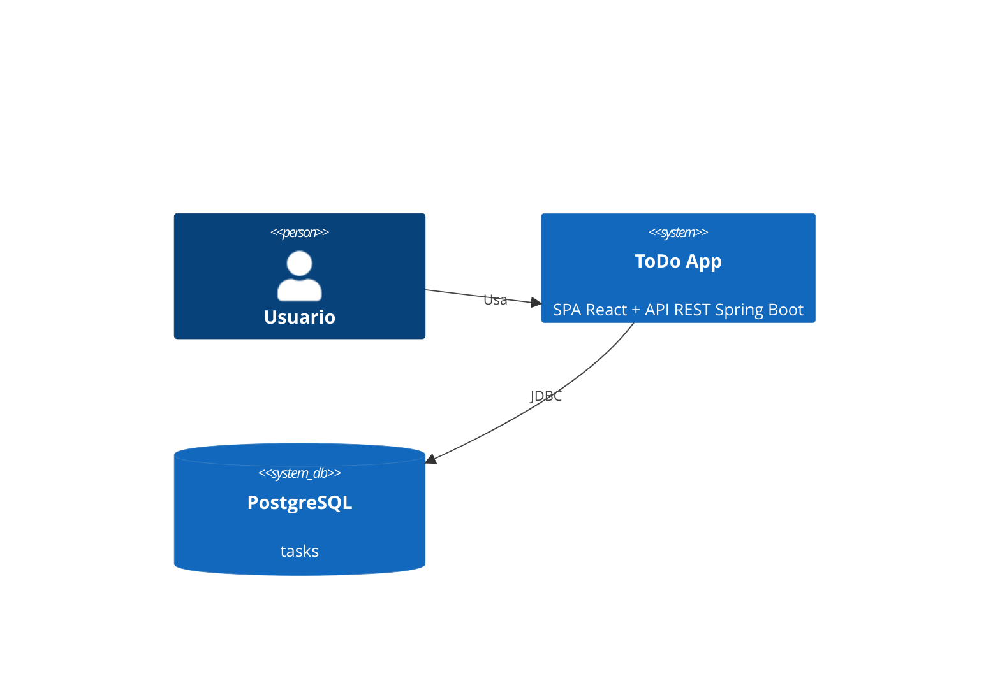
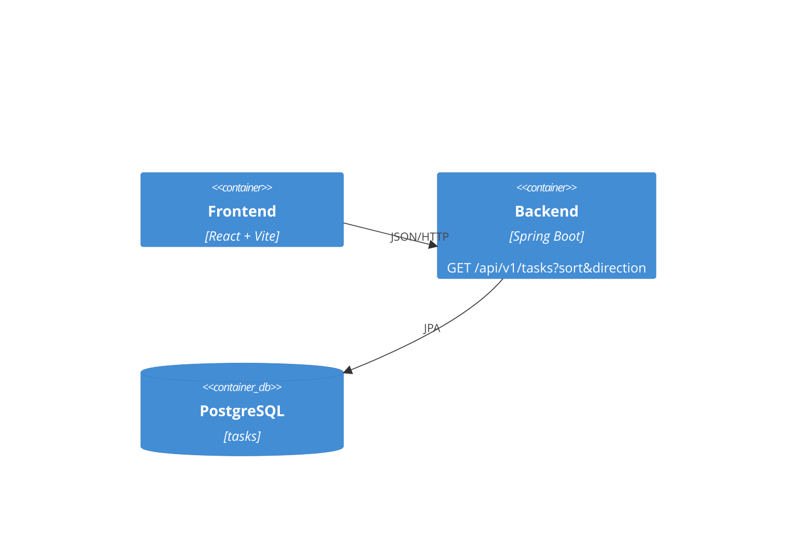
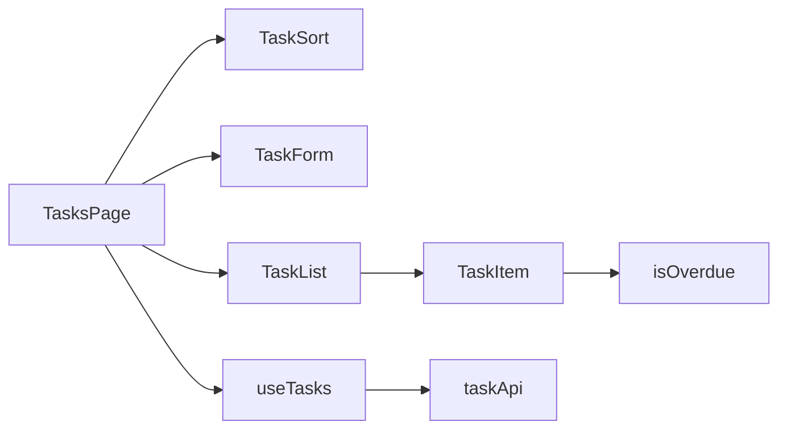
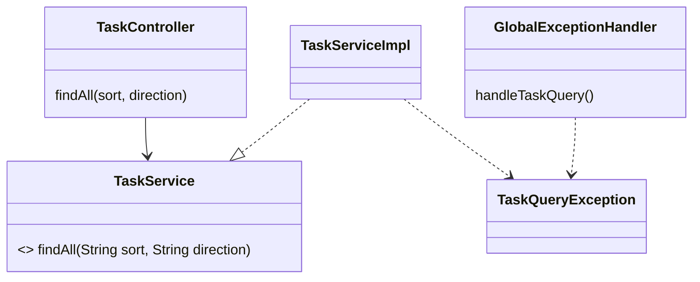

# Diagramas REQ-02
No existian diagramas previos en main: versiones minimas en Mermaid.

## C4 Contexto (sin cambios)

## C4 Contenedores (sin cambios estructurales)

## C4 Componentes (frontend)

## Clases

ER: sin cambios.
