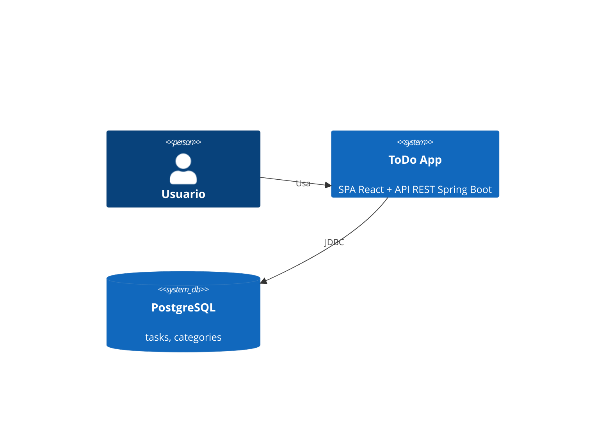
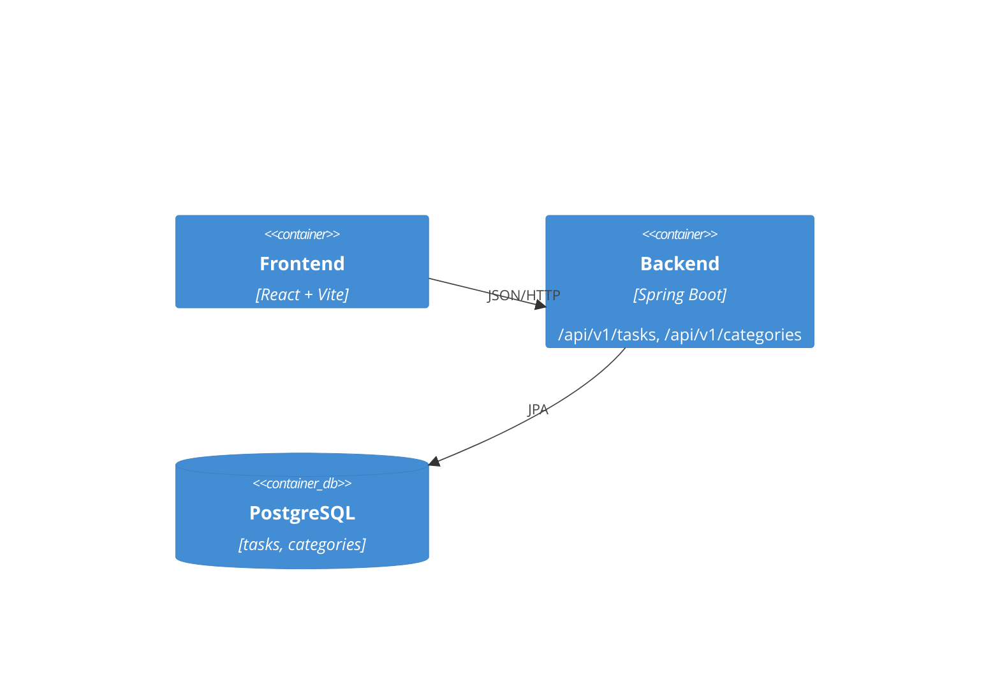
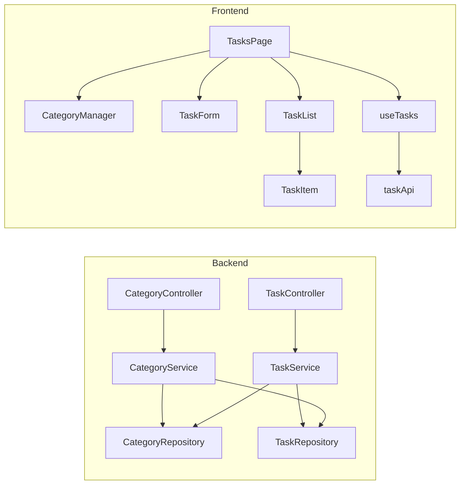
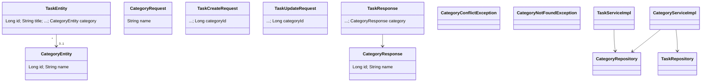
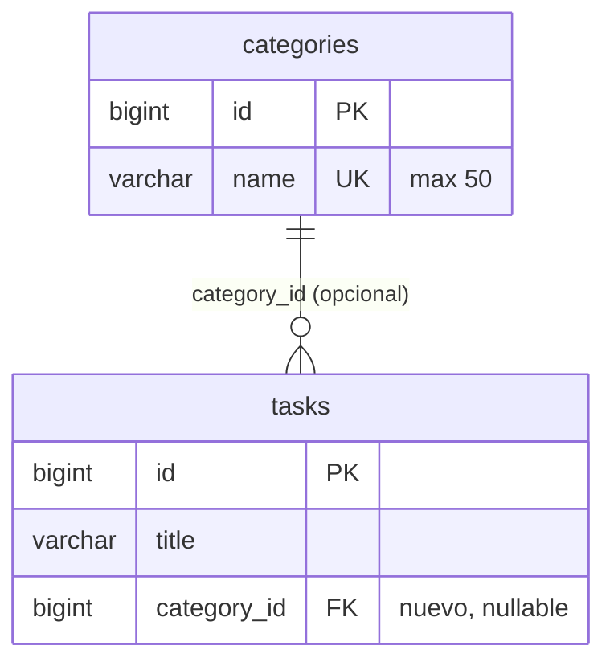

# Diagramas REQ-03
No existian diagramas previos en main: versiones minimas en Mermaid.

## C4 Contexto (sin cambios)

## C4 Contenedores (nuevo recurso /api/v1/categories y tabla categories)

## C4 Componentes (backend y frontend)

## Clases

## ER

