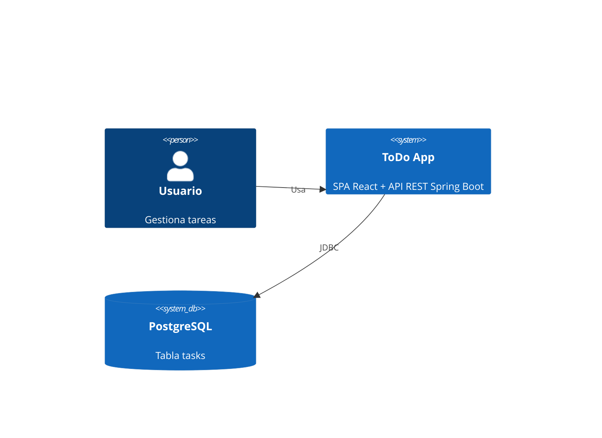
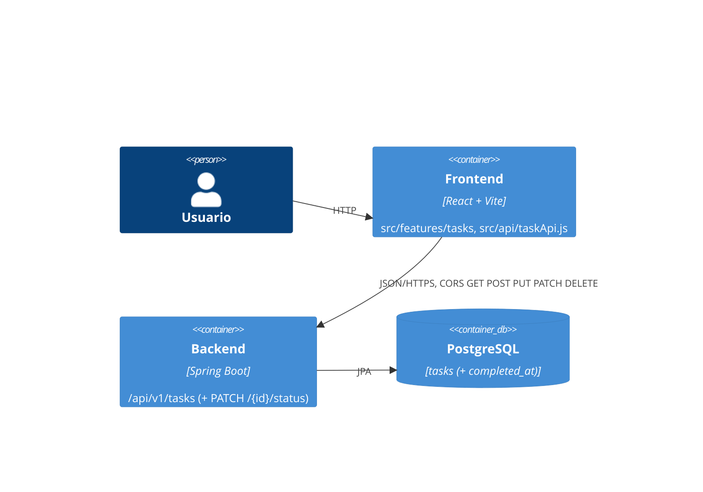
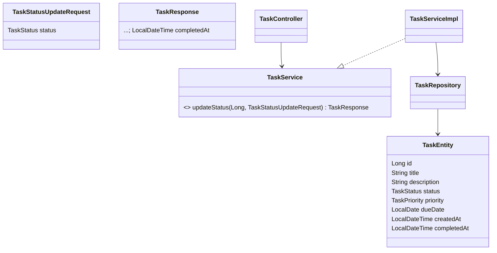
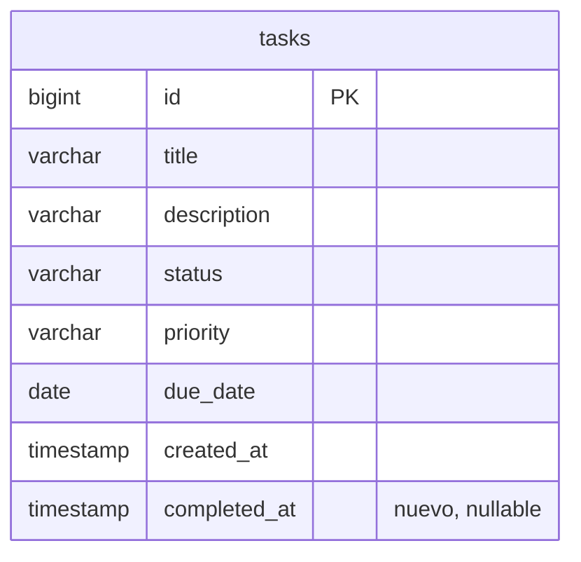

# Diagramas REQ-06
No existian diagramas previos en el repo: se crean versiones minimas en Mermaid (base para las demas ramas).

## C4 - Contexto

## C4 - Contenedores (sin cambios estructurales; se anade el endpoint PATCH)

Nivel Componentes: TaskController -> TaskService(Impl) -> TaskRepository; WebConfig (CORS). Sin componentes nuevos.

## Clases

## ER

